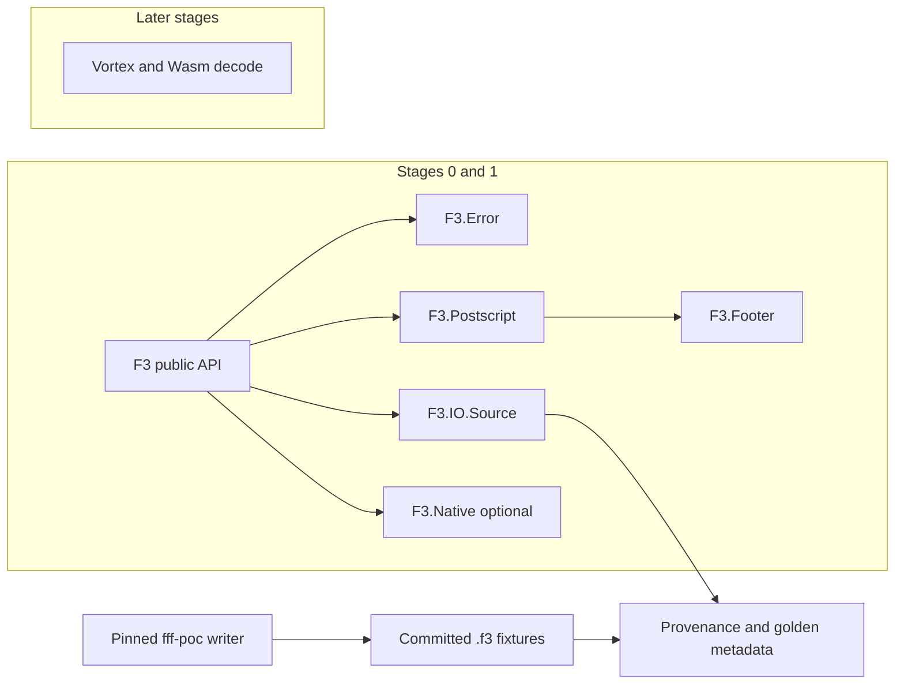

# Architecture

The library owns the byte-source lifecycle, the postscript, and a bounded FlatBuffers walk of the footer. Row decoding is still refused.

## Components

`F3` is the public module. `open/2` builds an `F3.File` around either `F3.IO.Local` or `F3.IO.Memory`. `close/1` returns the updated handle and is idempotent on that handle. `schema/1`, `metadata/1`, and `inspect/2` decode the tail when the handle is open. `read/2` and `stream/2` still return `:not_implemented` and do not scan the payload. `stream/2` does not build a `Stream`.

`F3.Format` holds the pinned magic, the 32-byte postscript layout, and `compatible?/2`. The only accepted wire version is 0.1. `F3.Postscript` reads that layout, rejects a short tail, a bad magic, any other version, a compressed footer, and a claimed size past the file or past `max_metadata_bytes:`. The default cap is 16 MiB and is an argument, not a process global.

`F3.FlatBuffer` walks one buffer: root offset, vtable, scalars, strings, vectors, and unions. Offsets are checked against the buffer length. Depth and the number of visited tables are capped. `F3.Footer` turns the footer and the out-of-band column-metadata roots into `F3.Schema`, `F3.Metadata`, and `F3.RowGroup`. Arrow types the fixtures do not use become `{:unsupported, id}` and do not fail the file. Wasm section offsets are recorded and the bytes are not read. Checksums are recorded and not verified.

`F3.Batch` is still an empty columnar struct. `to_rows/1` is not implemented. `F3.Writer` returns `:not_implemented` and creates no file.

`F3.Native` is a stable-Rust cdylib compiled only when `F3_BUILD_NATIVE=1`. Its one function returns the crate name and version. It does not link `fff-poc`, Arrow, Vortex, or Wasmtime.

There is no `Application` callback, no supervision tree, and no process registry. See [decisions/0001-hybrid-elixir-rust.md](decisions/0001-hybrid-elixir-rust.md).

## What Stage 2 may add

A narrow NIF for Vortex and Arrow decoding of types the fixtures actually contain. Projection, row groups, and a lazy `F3.stream/2`. That NIF must not install a process-global allocator and must not run on the normal BEAM scheduler for long decodes.

## Fixture path

`scripts/fixtures/generate.sh` clones the pinned commit into gitignored `tmp/upstream-f3`, copies `scripts/fixtures/generator/src/main.rs` to `fff-poc/src/bin/f3_fixture_gen.rs` in that checkout, and builds it with `cargo build --locked`. `scripts/fixtures/dump_metadata.sh` runs the pinned reader once and writes `test/fixtures/golden/*.json`. `mix test` checks the manifest and those JSON files. It does not compile upstream.
