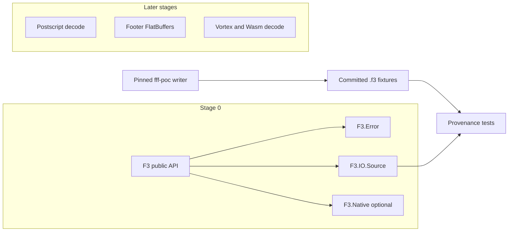

# Architecture

Stage 0 is a library with a byte-source lifecycle and an explicit refusal to decode. Later stages add parsers and decoders behind the same Elixir types.

## Components

`F3` is the public module. `open/2` builds an `F3.File` around either `F3.IO.Local` or `F3.IO.Memory`. `close/1` is idempotent. Schema, metadata, read, stream, and inspect check that the handle is open and then return `F3.Error` with category `:not_implemented`. `stream/2` does not build a `Stream` and does not read bytes.

`F3.Format` holds the pinned magic, the 32-byte postscript layout, and `compatible?/2`. The only accepted wire version is 0.1.

`F3.Schema`, `F3.Metadata`, `F3.RowGroup`, and `F3.Batch` are the types later stages will fill. Nothing in Stage 0 constructs them from a file. `F3.Batch` is columnar. `to_rows/1` is a separate adapter and is not implemented.

`F3.Writer` returns `:not_implemented` and creates no file.

`F3.Native` is a stable-Rust cdylib compiled only when `F3_BUILD_NATIVE=1`. Its one function returns the crate name and version. It does not link `fff-poc`, Arrow, Vortex, or Wasmtime.

There is no `Application` callback, no supervision tree, and no process registry.

## What Stage 1 may add

A pure-Elixir postscript reader that uses `F3.Format.postscript_layout/0`, checks magic and version, and refuses sizes that overflow the file. A bounded FlatBuffers walk of the footer, checked against the pinned `File.fbs` and the upstream reader on these fixtures. See [decisions/0001-hybrid-elixir-rust.md](decisions/0001-hybrid-elixir-rust.md).

## What Stage 2 may add

A narrow NIF for Vortex and Arrow decoding of types the fixtures actually contain. Projection, row groups, and a lazy `F3.stream/2`. That NIF must not install a process-global allocator and must not run on the normal BEAM scheduler for long decodes.

## Fixture path

`scripts/fixtures/generate.sh` clones the pinned commit into gitignored `tmp/upstream-f3`, copies `scripts/fixtures/generator/src/main.rs` to `fff-poc/src/bin/f3_fixture_gen.rs` in that checkout, and builds it with `cargo build --locked`. `test/fixtures/manifest.json` records SHA-256, size, schema intent, and row values. `mix test` checks the manifest. It does not compile upstream.
