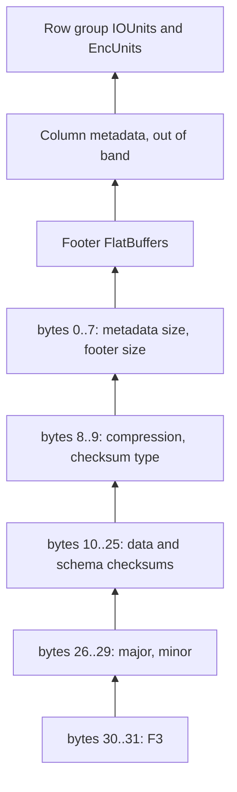

# F3 in detail

You do not need the byte layout to read a file. This page is the map behind `F3.inspect/2`, so a size or a checksum in the output has a place to land.

The writer appends a 32-byte postscript. The last two bytes are `F3`. The fields, from the start of those 32 bytes, are metadata size, footer size, footer compression, checksum type, data checksum, schema checksum, major version, minor version, and the magic. Integers are little-endian. This library accepts major 0 and minor 1 only.

The committed `test/fixtures/small.f3` is 4168 bytes. Its postscript starts at offset 4136. Metadata size is 1168. Footer size is 792. Footer compression is uncompressed. The checksum type is xxHash. The data checksum is `0x5415D4C0F14C1F51` and the schema checksum is `0xA2D956A3E70080C2`. `F3.inspect/2` prints those values. It does not recompute them.

The footer is a FlatBuffers table. It holds the Arrow schema, the row-group counts, and pointers. Column chunk metadata sits outside the footer, at offsets the footer names. A row group is a horizontal slice of the table. Inside it, an IOUnit is the unit of I/O and an EncUnit is the unit of encoding. The default writer uses an 8 MiB IOUnit and a 65536-value EncUnit. `small.f3` is shorter than one IOUnit. The metadata still describes the units.

`CASCADE` is the Vortex encoding. `CUSTOM_WASM` is an encoding unit that stays opaque unless you pass `wasm: :sandbox` or register an Elixir decoder. The inspector records a Wasm section as an offset. It does not execute it.

## Types

The writer in this library accepts:

- signed `int64` and `int32`
- unsigned `int64`, `int32`, `int16`, and `int8`
- `float64` and `float32`
- `bool` and `utf8`
- nullable forms of those primitives
- lists and structs of those primitives

A field you read back uses the same names. A type the footer names and this library does not claim becomes `{:unsupported, id}` on the schema. That alone does not reject the file. Decoding a shared dictionary is refused. Signed `int8` and `int16`, `float16`, plain binary, decimal, dates, timestamps, maps, and Arrow dictionary columns are outside this version.

## What a read returns

`F3.read/2` returns a list of `%F3.Batch{}`. Each batch holds columns keyed by field name. `F3.Batch.to_rows/1` zips one batch into maps. Keep the columns when the file is large. The [reading](06-reading.md) page is the call. The [writing](05-writing.md) page is the reverse direction.
