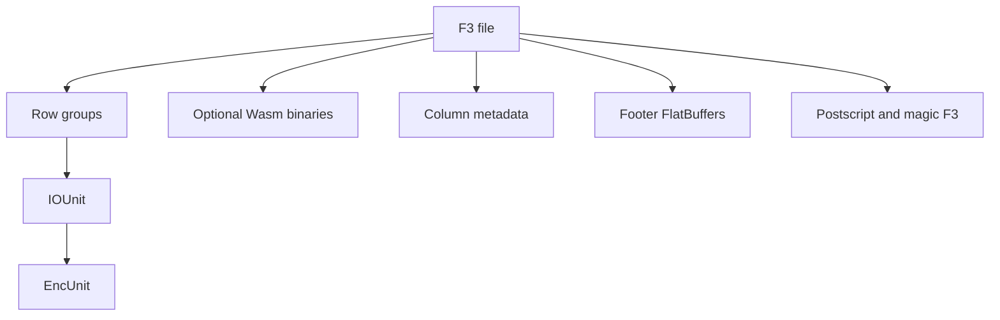

# Why another file format? Introducing F3

**Status:** technically reviewed  
**Audience:** Elixir engineers who already know Parquet or another columnar format well enough to use it, and who have not read the F3 paper.  
**Estimated reading time:** 8 minutes, estimated from length, not from a timed reading.  
**Upstream pin:** `bd92506447dc1333820cfe9a34ebbf497fe0219e`

F3 is a research file format. The upstream project says not to use it in production. The Elixir library in this repository is an experiment on top of that prototype. It does not read rows yet. Nothing in this article is a measurement of Elixir throughput.

## Why look at another columnar format?

Parquet and ORC made it normal to move analytical data between engines. Both came out of the early 2010s, when the systems around them were Hive, Impala, and early Spark. They have been extended since. The awkward part is not that the specifications froze. It is that a specification change does not arrive in every reader at once. The F3 paper's look at a few hundred public Parquet files found that most of them still use a small, old subset of the format. A new encoding or a new timestamp unit is only useful if the reader on the other side of the exchange understands it.

That is a real constraint. It is not a reason to talk as if Parquet has stopped working. It is a reason the F3 authors tried a different split: keep a stable way to find bytes in the file, and let an unfamiliar encoding carry its own decoder.

## What F3 is trying to be

The paper states three goals: interoperability, extensibility, and efficiency. A file is self-describing when a reader can find the schema, the locations of the columns, and, when the encoding is not one the reader was built with, a decoder that ships with the file. F3 puts the data, the metadata, and optional WebAssembly decoders in the same file. The paper reports that those binaries are on the order of kilobytes, and that in the authors' own experiments Wasm decoding was about 10–30% slower than a native decoder. Those numbers belong to that paper and that setup. This library has not reproduced them.

The format still uses a PAX layout, the same broad idea as Parquet and ORC: columns are stored together so a query can skip the ones it does not need. The authors' extra moves are about the units inside a column.

An **IOUnit** is a physical chunk of bytes the writer flushes. Its size is a storage choice. A spinning disk, a large SSD, and an object store do not want the same read size, and that choice should not have to be the same as the logical row group.

An **EncUnit** is a run of values that share one encoding. The default in the pinned writer is 65536 values, and the encoded size of that run can vary. IOUnits and EncUnits are different things. One IOUnit can hold several EncUnits. The schema still calls an IOUnit a `Chunk` in places. That name is historical.

A **row group** is the logical horizontal stripe. The pinned writer defaults to one row group per file and can be told to start another after a row threshold.

Encodings in the pinned schema are `CASCADE` (0), implemented with Vortex, and `CUSTOM_WASM` (255), which must be decoded by a Wasm binary stored in the file. A reader is not required to execute that binary. This Elixir library does not.



The footer points at column metadata. It is not a copy of every IOUnit header. The postscript is 32 little-endian bytes at the end of the file, and the last two of those bytes are the ASCII magic `F3`.

## What the Elixir library is for

The library is a separate project. It uses the module `F3` and, if it is ever published, the Hex name `f3`. On 2026-11-03 that Hex name was unused. The library pins one upstream commit and wire version 0.1. Opening a file acquires a byte source. Schema and footer metadata are decoded from the tail. Asking for rows returns `{:error, %F3.Error{category: :not_implemented}}`.

From the repository root:

```shell
mix run examples/tutorial_01.exs
```

The script prints the pinned wire version. Writing is not implemented. Reading rows is implemented when the native decoder is compiled.

## Glossary

| Term | Meaning in the pinned sources |
| --- | --- |
| Postscript | 32-byte tail. Sizes, checksums, version, then `F3`. Not FlatBuffers. |
| Footer | FlatBuffers root table. Arrow IPC schema and pointers. |
| Row group | Logical set of rows. |
| IOUnit | Physical write unit. Called `Chunk` in `File.fbs`. |
| EncUnit | Values that share one encoding, contiguous inside an IOUnit. |
| CASCADE | Encoding type 0. Vortex in the upstream writer. |
| CUSTOM_WASM | Encoding type 255. Decode with the file's Wasm binary. |

## What is experimental?

Upstream F3 at `bd92506447dc1333820cfe9a34ebbf497fe0219e` is a research prototype. The schema file says the definition can change. The Elixir code decodes the footer. When `F3_BUILD_NATIVE=1` it also decodes the CASCADE payloads in the committed fixtures. It does not run Wasm. Wire versions other than 0.1 are rejected. There are no Elixir performance numbers in this article.

## Next

[Anatomy of an F3 file](02-anatomy-of-an-f3-file.md) walks the same layout from the magic backward, using a file the pinned writer actually produced.

## Sources

- Zeng, Meng, Prammer, McKinney, Patel, Pavlo, and Zhang, "F3: The Open-Source Data File Format for the Future", Proc. ACM Manag. Data 3, 4, Article 245 (2025). https://doi.org/10.1145/3749163
- Upstream repository and prototype warning: https://github.com/future-file-format/F3
- Pinned schema: https://github.com/future-file-format/F3/blob/bd92506447dc1333820cfe9a34ebbf497fe0219e/format/File.fbs
- Pinned version constants: `fff-format/src/lib.rs` at that commit (`MAJOR_VERSION` 0, `MINOR_VERSION` 1, `MAGIC` `F3`, `POSTSCRIPT_SIZE` 32)
