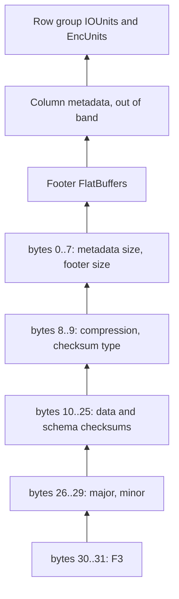

# Anatomy of an F3 file

**Status:** technically reviewed  
**Audience:** the reader of tutorial 1 who wants the byte layout, not a decoder.  
**Estimated reading time:** 10 minutes, estimated from length, not from a timed reading.  
**Upstream pin:** `bd92506447dc1333820cfe9a34ebbf497fe0219e`  
**Fixture:** `test/fixtures/small.f3`, produced by the pinned `FileWriter`

`F3.inspect/2` does not exist as a working inspector yet. It returns `:not_implemented`. The dump below is a print of the last 32 bytes of a real fixture. It is not a FlatBuffers parser.

## Start at the end

A reader that does not know the file's length cannot find the footer, because the footer is not at a fixed offset. The writer appends a postscript whose size is fixed. In the pinned sources that size is 32 bytes, little-endian, and the last two bytes are `F3`.

The fields, in order, are metadata size, footer size, footer compression, checksum type, data checksum, schema checksum, major version, minor version, and the magic. `F3.Format.postscript_layout/0` is that list of widths. Stage 1 will turn it into a parser with bounds checks. This article only prints the tail.

Metadata size, in the schema comment, is the span a reader can fetch in one I/O to get the metadata: the file size minus the data and minus the postscript. Footer size is the FlatBuffers footer inside that span. The writer currently stores footer compression as uncompressed (0) and the checksum type as xxHash (0). The data checksum covers the file payload in schema order. The schema checksum covers the serialized Arrow IPC schema. Both are u64 values. This dump does not recompute them.

## What sits in front of the postscript

Walking backward from the postscript, the pinned `File.fbs` comment describes:

1. The footer, a FlatBuffers table. It holds the Arrow IPC schema, row-group row counts, and pointers. Column chunk metadata is not inlined. The footer points at it.
2. Optional sections. Today the writer uses them for Wasm binaries. Statistics are mentioned as future or out-of-band work.
3. Per-row-group column metadata: IOUnit offset and size, EncUnit encoding, dictionary information.
4. The Wasm binaries themselves, if the writer was asked to embed them.
5. The row groups: IOUnits, and inside them EncUnits.

An IOUnit is the unit of I/O. An EncUnit is the unit of encoding. They are different because a storage read and an encoding block do not have to be the same size. The default writer uses an 8 MiB IOUnit and a 65536-value EncUnit. A small fixture does not fill an 8 MiB IOUnit. The units still exist in the metadata; the file is just short.

`CASCADE` (0) means Vortex. `CUSTOM_WASM` (255) means the EncUnit is opaque without the Wasm decoder stored in the file. The small fixture uses the default writer path: no built-in Wasm flag, `EncoderDictionary`, uncompressed. Whether a later fixture in `test/fixtures/` embeds Wasm is recorded in `manifest.json`. This library does not execute it.



The diagram is the tail, then the metadata the tail locates, then the data. Offsets inside the postscript are from the start of those 32 bytes.

## A real tail

Command, from the repository root:

```shell
mix run examples/tutorial_02.exs
```

The script reads `test/fixtures/small.f3` unless `F3_FIXTURE` names another committed fixture. This is the stdout of that command against the committed `small.f3`:

```text
command: mix run examples/tutorial_02.exs
fixture: test/fixtures/small.f3
bytes: 4168
sha256: 6f1ff9d7202c3f0d8f910a4ef154ba195cd225804d261ca752339cc8fc123a13
postscript_offset: 4136
postscript_size: 32
metadata_size: 1168
footer_size: 792
footer_compression: 0
checksum_type: 0
data_checksum: 0x5415d4c0f14c1f51
schema_checksum: 0xa2d956a3e70080c2
major_version: 0
minor_version: 1
magic: F3
tail_hex:
  00001028: 90 04 00 00 18 03 00 00 00 00 51 1f 4c f1 c0 d4
  00001038: 15 54 c2 80 00 e7 a3 56 d9 a2 00 00 01 00 46 33
```

`90 04 00 00` is metadata size 1168. `18 03 00 00` is footer size 792. The last two bytes are `46 33`, which is `F3`. Major is `00 00` and minor is `01 00`, so version 0.1. Footer compression and checksum type are the zero bytes between the sizes and the checksums. The manifest test checks this file's SHA-256, so a regenerated fixture must replace this block from a new run of the same command.

## What is experimental?

The layout comes from `format/File.fbs` and `FileWriter::finish` at `bd92506447dc1333820cfe9a34ebbf497fe0219e`. The schema says it can change. This article does not decode the footer, does not check the checksums, and does not show `F3.inspect/2` output, because that function is not implemented. Unknown checksum bytes panic in the upstream converter. This dump does not call that converter.

## Next

Tutorial 3, when Stage 1 exists, will open this fixture in IEx and print schema and metadata. Until then, `F3.schema/1` returns `:not_implemented` on purpose.

## Sources

- Pinned schema comment and tables: https://github.com/future-file-format/F3/blob/bd92506447dc1333820cfe9a34ebbf497fe0219e/format/File.fbs
- Writer tail: `fff-poc/src/writer.rs`, `finish`, at the same commit
- Constants: `fff-format/src/lib.rs` (`POSTSCRIPT_SIZE` 32, `MAGIC` `F3`, version 0.1)
- Paper sections 3 and 4, for IOUnit versus row group and for FlatBuffers metadata: https://doi.org/10.1145/3749163
