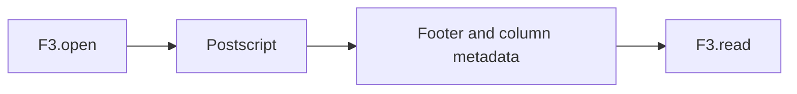

# Your first F3 file in Elixir

**Status:** technically reviewed  
**Audience:** an Elixir engineer who can run `mix` in this repository.  
**Estimated reading time:** 8 minutes, estimated from length, not from a timed reading.  
**Upstream pin:** `bd92506447dc1333820cfe9a34ebbf497fe0219e`

This article opens a committed fixture, prints the schema, and reads the rows. The row decoder is a native library. The default `mix test` build does not compile it. With `F3_BUILD_NATIVE=1`, `F3.read/2` returns the three rows of `small.f3`.

## Setup

The project pins Elixir 1.20.2 on OTP 28. `mix test` does not need Rust. The CASCADE decoder is compiled only when `F3_BUILD_NATIVE=1`, and it uses Rust `nightly-2025-11-15`. Without that flag, `F3.read/2` returns `:native_unavailable` and metadata inspection still works.

```shell
mix deps.get
mix test
mix f3.inspect test/fixtures/small.f3
```

`test/fixtures/small.f3` was written by the pinned upstream `FileWriter`. Do not replace it with a hand-built file. The manifest records its SHA-256.

## Open, inspect, close

`F3.open/2` returns `{:ok, file}` or `{:error, %F3.Error{}}`. A missing path is `:not_found`. A file that is too short is `:truncated`. A bad magic is `:invalid_magic`. A version other than 0.1 is `:unsupported_version`.

```elixir
{:ok, file} = F3.open("test/fixtures/small.f3")
{:ok, schema} = F3.schema(file)
{:ok, metadata} = F3.metadata(file)
{:ok, [batch]} = F3.read(file)
{:ok, rows} = F3.Batch.to_rows(batch)
{:ok, file} = F3.close(file)
```

`F3.read/2` returns columnar batches. `F3.Batch.to_rows/1` zips those columns into maps. That zip is the convenience path. `close/1` returns the updated handle. Keep that value. The previous struct still looks open, and a read on it fails as I/O because the descriptor is already closed. Calling `close/1` again on the returned handle is a no-op. Using that returned handle is `:closed`.

`examples/tutorial_03.exs` prints the fields from that fixture:

```text
command: mix run examples/tutorial_03.exs
fields:
  trade_id int64
  symbol utf8
  price float64
row_groups: 1
rows: 3
read:
[
  %{"price" => 123.5, "symbol" => "AAPL", "trade_id" => 1},
  %{"price" => 234.0, "symbol" => "MSFT", "trade_id" => 2},
  %{"price" => 345.25, "symbol" => "GOOG", "trade_id" => 3}
]
inspect:
version: 0.1
rows: 3
row_groups: 1
schema: trade_id int64, symbol utf8, price float64
footer_bytes: 792
metadata_bytes: 1168
footer_compression: uncompressed
checksum_type: xxhash
data_checksum: 0x5415D4C0F14C1F51
schema_checksum: 0xA2D956A3E70080C2
after close: closed
```

That `read:` block is the output of `F3_BUILD_NATIVE=1 mix run examples/tutorial_03.exs` on this machine. A build without the native decoder prints `read: native decoder is not loaded` instead, and the rest of the script is the same. The same script then tries a one-row write. The default build prints `write: native writer is not loaded` and creates no file. The checksums are displayed, not verified.

`max_metadata_bytes:` on `schema/1`, `metadata/1`, and `inspect/2` caps the sizes in the tail. The default is 16 MiB. A larger claim returns `:resource_limit` and does not allocate that buffer.



The postscript is the only fixed-position record. The footer is the FlatBuffers table at the end of the metadata span. Column chunks are separate FlatBuffers roots just before that footer. `F3.schema/1` is the Arrow IPC schema stored in the footer. `F3.metadata/1` adds row groups, IOUnits, EncUnits, encoding versions, and Wasm pointers.

## What is experimental?

Upstream F3 at `bd92506447dc1333820cfe9a34ebbf497fe0219e` is a research prototype. This Elixir build matches that reader's metadata on the eight committed fixtures. With the native decoder it also matches the row values. Wasm bytes are not executed. Footer compression other than uncompressed is refused. Nothing here is a production reader.

## Next

Tutorial 4 streams a file and projects columns. `to_rows/1` stays the convenience path. Tutorial 5 writes a local file and reads it back.

## Sources

- Public calls: `F3.open/2`, `F3.schema/1`, `F3.metadata/1`, `F3.inspect/2`
- Example: `examples/tutorial_03.exs`
- Fixture provenance: `test/fixtures/manifest.json` and `test/fixtures/golden/small.json`
