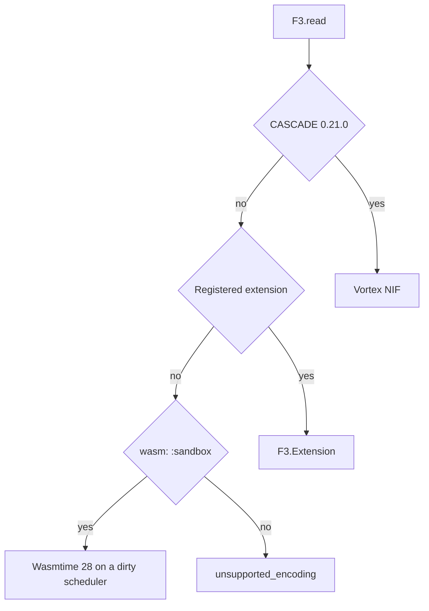

# Taking the decoder with the data

**Status:** technically reviewed

**Audience:** an Elixir engineer who has read a CASCADE file and wants to know what `CUSTOM_WASM` does in this build.

**Estimated reading time:** 8 minutes. That is the author's estimate, not a measurement.

**Pin:** upstream F3 `bd92506447dc1333820cfe9a34ebbf497fe0219e`. This article does not apply to any other commit.

F3 can store a decoder next to the bytes it decodes. The pinned writer does that for `custom_wasm.f3` by embedding `fff-ude-example-fff`, compiled for `wasm32-wasip1`. The encoding label on those units is `CUSTOM_WASM`. The Wasm ABI symbol is `FFFUDE_VERSION_1_0`. This library accepts major 1 only.

An Elixir extension is not an F3 file field. `F3.Registry` is process-local policy. Two reads share it only when both are given the same pid.



`examples/tutorial_06.exs` opens `test/fixtures/custom_wasm.f3`. The default read does not execute the module:

```text
command: mix run examples/tutorial_06.exs
wasm: off
extension rows:
[%{"trade_id" => 1}, %{"trade_id" => 2}, %{"trade_id" => 3}]
wasm: sandbox needs the native decoder
```

That block is `mix run examples/tutorial_06.exs` without `F3_BUILD_NATIVE`. The extension returns the manifest rows. It does not prove the embedded module. With the native decoder compiled, the same script's sandbox branch prints:

```text
sandbox rows:
[%{"trade_id" => 1}, %{"trade_id" => 2}, %{"trade_id" => 3}]
```

That second list is `F3_BUILD_NATIVE=1 mix run examples/tutorial_06.exs` on this machine. The fuel budget is 5_000_000 instructions. Upstream sets no fuel. Linear memory is capped at 8 MiB. `lib_urls` are not fetched.

## What is experimental?

Upstream F3 at this pin is a research prototype. Wasm stays off unless the caller passes `wasm: :sandbox`. Majors 2 and 3 of the ABI are not accepted. Nested Wasm output is not implemented upstream and is not claimed here. `small.f3` remains a Vortex file. Nothing here is a production sandbox.

## Next

Tutorial 5 is the writer. It is not implemented. Wasm stays opt-in after that stage.

## Sources

- Pinned `fff-ude/src/ffi.rs`, `fff-ude-wasm/src/lib.rs`, and `fff-poc/src/decoder/encunit.rs`
- `test/fixtures/custom_wasm.f3` and `test/fixtures/manifest.json`
- `docs/upstream-compatibility.md` and `docs/security.md`
- Example: `examples/tutorial_06.exs`
