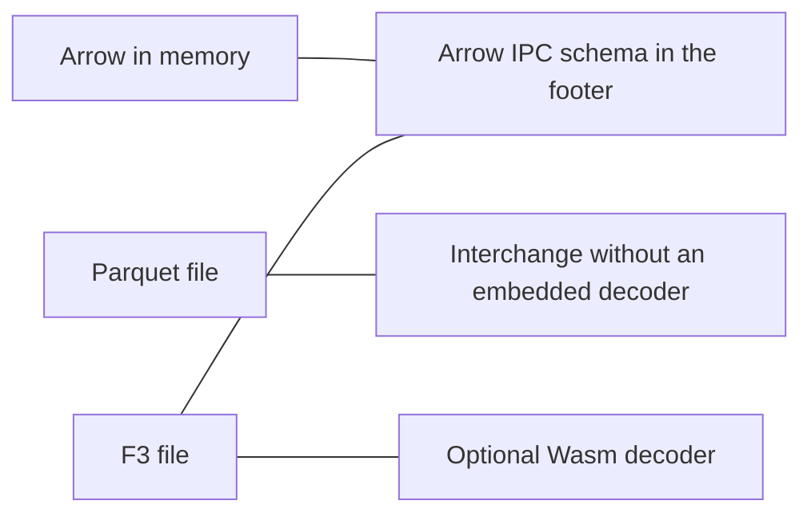

# F3, Apache Arrow, and Parquet

**Status:** technically reviewed  
**Audience:** people who already use Arrow or Parquet and want to know which job F3 is claiming.  
**Estimated reading time:** 7 minutes, estimated from length, not from a timed reading.  
**Upstream pin:** `bd92506447dc1333820cfe9a34ebbf497fe0219e`

This article compares jobs. It does not compare speeds. The recorded benchmark did not run a Parquet tool. See tutorial 9 for that run.

## Three jobs

Apache Arrow is an in-memory columnar representation. Engines pass arrays to each other without first agreeing on a file. The F3 footer stores an Arrow IPC schema so a reader can name fields and types. That schema is metadata. It is not an Arrow C Data Interface, and this library does not return Arrow arrays across the NIF. A decoded batch is an Elixir term.

Apache Parquet is a file format for exchanging columnar data. Readers in many languages already agree on it. A Parquet file does not carry a new decoder for an encoding the reader has never seen. That is the constraint the F3 paper is arguing with. This library does not read or write Parquet.

F3 is a research file format. The pinned writer puts Vortex-encoded values in the file, or a Wasm decoder when the writer was asked for one. A reader can refuse that decoder. This library does: `wasm: :off` is the default, and `:sandbox` is the only other accepted value.



## What this library actually opens

`small.f3` is three rows and an Arrow IPC schema in the footer. `F3.schema/1` returns that schema. `F3.read/2` returns columnar batches when the native decoder is compiled, and `:native_unavailable` when it is not. Neither call produces a Parquet file or an Arrow array.

From the repository root:

```shell
mix run examples/tutorial_07.exs
```

The script prints the three jobs and the schema line for `small.f3`. It does not print a timing.

## What is experimental?

Upstream F3 at this pin is a research prototype. The footer schema is Arrow IPC. The payloads are not Parquet row groups and they are not Arrow arrays. Shared dictionaries are still `:unsupported_encoding`. Nothing here says F3 is faster or slower than Parquet.

## Next

[Building a safe binary-file reader on the BEAM](08-a-safe-reader-on-the-beam.md) is the bounds and the opt-in paths. Tutorial 9 is the only place that quotes a measured run.

## Sources

- Zeng, Meng, Prammer, McKinney, Patel, Pavlo, and Zhang, "F3: The Open-Source Data File Format for the Future", Proc. ACM Manag. Data 3, 4, Article 245 (2025). https://doi.org/10.1145/3749163
- Example: `examples/tutorial_07.exs`
- Fixture: `test/fixtures/small.f3`
