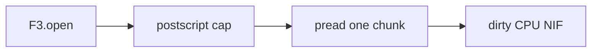

# Building a safe binary-file reader on the BEAM

**Status:** technically reviewed  
**Audience:** Elixir engineers who read untrusted binaries.  
**Estimated reading time:** 8 minutes, estimated from length, not from a timed reading.  
**Upstream pin:** `bd92506447dc1333820cfe9a34ebbf497fe0219e`

The rules below are the ones this library implements. They are not a general BEAM security guide.

## The tail is the allocation

The postscript is 32 bytes. `metadata_size` and `footer_size` are integers in that tail, so they are attacker-controlled. `F3.Postscript.max_metadata_bytes/0` is 16_777_216 (16 MiB). A larger claim is `:resource_limit` and is not allocated. The cap is an argument to `schema/1`, `metadata/1`, and `inspect/2`. It is not a process global.

`pread/3` returns at most the requested length. A read at or past the end returns an empty binary. It does not raise.

## The NIF stays on a dirty scheduler

CASCADE decoding runs in `f3_native` on the dirty CPU scheduler, and only when `F3_BUILD_NATIVE=1`. The NIF does not link `fff-poc` and it does not install a global allocator. Arrow buffers do not cross into Elixir. A panic becomes `{:error, %F3.Error{}}`. Without that build, `F3.read/2` returns `:native_unavailable` and does not scan the payload.

## Wasm is opt-in

`wasm:` defaults to `:off`. `CUSTOM_WASM` is then `:unsupported_encoding`, and the `WASMBinaries` section is not read. `:sandbox` runs Wasmtime 28 with a 16 MiB module ceiling, 8 MiB of linear memory, and 5_000_000 units of fuel. There is no preopened directory. `lib_urls` in the footer are not fetched.

## Remote bytes are also opt-in

`source: {:http, url}` sends one `HEAD` and then one ranged `GET` per `pread/3`. Redirects are refused. A local `F3.schema/1` does not open a socket. The writer still renames a temp file on the local filesystem.

`Inspect` prints an origin, a size, and a closed flag. It does not print file bytes, request headers, or a signing secret.



From the repository root:

```shell
mix run examples/tutorial_08.exs
```

The script prints the 16 MiB cap, the default Wasm mode, and the read result for `small.f3` on this build.

## What is experimental?

The caps are tested. They are not a sandbox for the BEAM, and they are not a claim that every native dependency is audited. A shared dictionary is still refused. Hex has not been published.

## Next

[Performance, compatibility, and what remains experimental](09-performance-and-what-remains-experimental.md) quotes the benchmark script and names what is still off.

## Sources

- `F3.Postscript.max_metadata_bytes/0`
- `docs/security.md`
- Example: `examples/tutorial_08.exs`
